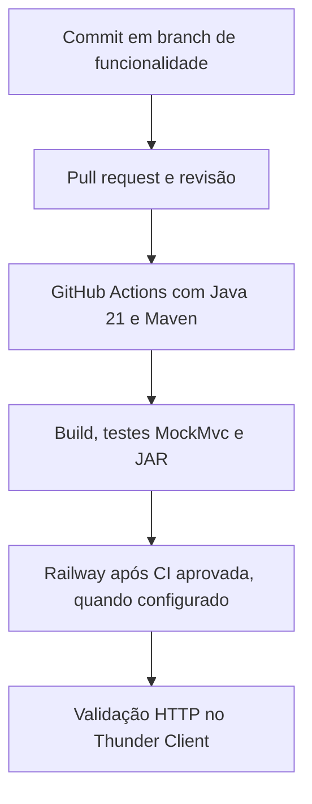

# Relatório de entrega — Monitoramento de máquinas

- **Nome:** preencher
- **RA:** preencher
- [Repositório](https://github.com/recheraphael-Re/aula11desbEX1_nota) · [Commits](https://github.com/recheraphael-Re/aula11desbEX1_nota/commits/main/) · [Branches](https://github.com/recheraphael-Re/aula11desbEX1_nota/branches) · [Pull requests](https://github.com/recheraphael-Re/aula11desbEX1_nota/pulls?q=is%3Apr) · [GitHub Actions](https://github.com/recheraphael-Re/aula11desbEX1_nota/actions)

## 1. API e validação local

A API cadastra, lista, altera e exclui máquinas. Ela registra consumo de energia, horário de acionamento e quantidade de peças, e permite consultar o histórico por máquina. Os modelos, o controlador, as regras de negócio e a leitura e escrita do JSON estão em pacotes separados. Veja a [documentação dos endpoints](README.md#2-endpoints).

| Verificação local | Resultado |
| --- | --- |
| Maven `verify` com Java 21 | JAR `monitoramento-1.0.0.jar` gerado, 6 testes MockMvc passaram |
| Consulta da aplicação | `GET /`, `GET /status` e `GET /versao` retornaram 200 |
| Operações de máquinas | Cadastro 201, listagem 200, alteração 200 e exclusão 204 |
| Produção | Registro 201, consulta e filtro por máquina 200 |
| Máquina inexistente | Nova tentativa de excluir a máquina retornou 404 |
| Reinício do JAR | O histórico da máquina excluída continuou acessível e o novo cadastro recebeu outro ID |

Os testes automatizados podem ser reproduzidos com `mvn -B verify` na pasta do exercício. Os XMLs e o resumo do Surefire ficam em `target/surefire-reports/`.

## 2. Fluxo DevOps

O workflow da raiz do repositório roda automaticamente em push para `main`, `develop` ou `feature/**` e em pull requests. Ele usa o Maven a partir da pasta que contém o `pom.xml` e guarda o JAR e os resultados dos testes. Na integração com o Railway, a opção **Wait for CI** aguarda o resultado antes do deploy. [Configuração de deploy automático](https://docs.railway.com/deployments/github-autodeploys)

## 3. Respostas às perguntas

1. **Como o versionamento dá rastreabilidade?** Os commits mostram quem alterou o código, o que mudou e quando. O pull request registra a finalidade da mudança, a revisão e as verificações antes de integrar.
2. **Por que automatizar testes em CI/CD?** Os testes verificam a aplicação a cada alteração, como o HTTP 201 do cadastro e o HTTP 404 de IDs inexistentes. Uma falha no CI pode bloquear a publicação e evitar regressões.
3. **Como o Docker padroniza o ambiente?** O Dockerfile usa Maven e Java 21 para compilar e uma imagem com Java 21 para rodar o mesmo JAR. Isso reduz diferenças de ambiente entre máquinas.
4. **Quais etapas o pipeline automatiza?** O GitHub Actions obtém o código, configura Java, resolve dependências, compila, executa o MockMvc e guarda o JAR e os resultados. O deploy pode ser automatizado no Railway após vincular o repositório e ativar **Wait for CI**.
5. **Como o monitoramento melhora a disponibilidade?** O endpoint `/status` permite consultar se a API responde. Com verificações periódicas e alertas, a equipe pode detectar uma falha e reduzir o tempo até o diagnóstico.
6. **Que problemas o deploy manual pode causar?** É possível enviar um JAR antigo, esquecer configurações de porta ou pular testes. Também fica mais difícil descobrir qual versão está em produção e repetir o procedimento.
7. **Como melhorar o processo?** Configurar o deploy condicionado ao CI, usar `/status` em verificações da aplicação publicada e registrar alertas quando a API falhar. Um volume de dados preserva o JSON entre redeploys.

Na explicação oral, mostre a sequência do pull request até a validação HTTP. A integração contínua verifica cada alteração. A entrega contínua mantém uma versão aprovada pronta para publicação. O deploy contínuo publica essa versão automaticamente após as verificações configuradas.

## 4. Evidências para anexar

- [ ] Capturas do repositório, histórico, branches e pull requests.
- [ ] Captura da execução local dos testes e da aprovação no GitHub Actions.
- [ ] Capturas de GET, POST, PUT e DELETE no Thunder Client com método, URL, status e resposta.
- [ ] URL pública do Railway e capturas da API acessível e do `GET /status` com HTTP 200.
